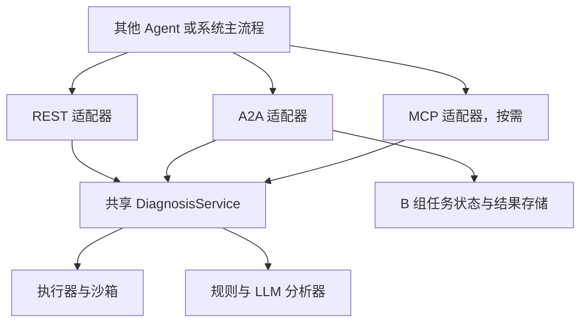

# B 组错误分析 Agent 接口与通信协议设计计划

设计日期：2026-10-09，更新日期：2026-10-10。状态：REST/统一契约、A2A 1.0 和 MCP 首版已实现；真实跨组联调待确认。实际支持范围和启动方式见 [接入说明](agent_interoperability.md) 和 [MCP 接入说明](mcp_integration.md)，本文件保留整体设计与后续阶段规划。

本计划面向本项目的独立对接能力：B 组接收需求、代码、测试或已有执行反馈，返回结构化诊断、修复建议和检索决策。其他组的实现框架和部署方式暂未确定，因此先固定 B 组的业务契约，再用标准协议暴露相同能力。

建议以 A2A 作为正式 Agent 协作入口，以 REST/OpenAPI 作为通用调用入口，按接入方需要增加 MCP 工具入口。三个入口共用业务服务与数据模型。B 组负责自己的执行与诊断任务生命周期；整个编程任务的生成、修复、检索调用和迭代终止仍由外层主流程控制。

## 1 当前基础与协议选择

当前已具备：

- `python_service/app/main.py`：FastAPI HTTP 接口。
- `python_service/app/schemas.py`：执行请求、执行反馈、错误分析结果等 Pydantic 模型。
- `python_service/app/analyzer/`：规则分类、模型根因解释和结果后处理。
- `python_service/app/sandbox/`：Python/Java 代码片段执行。
- `python_service/app/repository/`：可信本地仓库快照及 Docker pytest 执行。
- `codepilot/codepilot/pico/integrations/`：现有 CodePilot HTTP 适配器。

设计时现有业务可以复用，但尚未提供 A2A Server 或面向外部的 MCP Server。现已实现 A2A、MCP HTTP Server 和 stdio-to-REST 桥接器。现有 CodePilot 的 MCP 客户端仅支持本地 stdio，首选协议版本为 `2025-06-18`，通过桥接器接入，不假定其能够直接接入新版远程 MCP 服务。

| 层次 | 选择 | 本项目用途 | 建设优先级 |
| --- | --- | --- | --- |
| Agent 协作 | A2A | 发布 B 组能力，接收委托任务，管理诊断任务状态和结果 | 主线 |
| 普通服务调用 | REST + OpenAPI | 支持普通 HTTP 客户端、Apifox、脚本和现有 CodePilot 适配器 | 首先落地 |
| Agent 工具调用 | MCP | 将诊断、执行诊断、语法检查暴露成可发现工具 | 按接入需要落地 |
| 数据契约 | JSON + JSON Schema | 约定代码、测试、反馈和诊断报告 | 三种入口共用 |

A2A 面向独立 Agent 间的任务协作，MCP 面向工具和资源接入，这两类能力可以互补。上述优先级是针对本项目的工程建议，并不要求其他组采用相同框架。[A2A 与 MCP 的官方说明](https://a2a-protocol.org/latest/topics/a2a-and-mcp/)

截至本次核对，A2A 官方发布版本为 `1.0.0`，请求协商使用 `1.0`；MCP 官方 latest 文档对应 `2026-07-28`。实际实施时锁定已验证的 SDK 和协议版本，并测试接入方支持的版本。旧版本兼容必须显式实现，不能混用不同版本的方法名、消息格式和握手规则。[A2A 版本化规范](https://a2a-protocol.org/v1.0.0/specification/#36-versioning)、[MCP 当前规范](https://modelcontextprotocol.io/specification/2026-07-28)

## 2 服务边界与整体结构



业务服务在进程内被适配器调用，避免同一服务中的 A2A/MCP 入口再次通过 HTTP 调用自己的 REST 接口。独立启动的 stdio MCP 桥接进程则可以调用 B 组 REST 服务。

初期发布的业务能力：

| 能力 ID | 输入 | 输出 | 初期范围 |
| --- | --- | --- | --- |
| `diagnose_error` | 原始需求、代码上下文、已有执行反馈 | 结构化诊断报告 | 主要对接能力 |
| `execute_and_diagnose` | 需求、代码片段、输入输出测试 | 执行反馈及可空诊断报告 | Python/Java，固定执行配置 |
| `check_syntax` | 代码片段 | 语法检查反馈 | 验证语法，不代表测试通过 |
| `execute_repository_and_diagnose` | 受控仓库引用、pytest 目标 | 仓库测试反馈及诊断 | 工件来源与执行环境就绪后开放 |

修复后的代码通过相同执行诊断能力复测，附带 `previousReportId` 和代码版本信息。上一轮草案中的独立 `validate-repair` 接口首版可以不新增，后续确有独立比较或验证策略时再添加。

B 组返回 `needRetrieval` 和查询建议。实际 RAG 查询及检索结果融合由外层流程或修复模块负责；协议接入本身不改变当前检索判断的实现。

## 3 统一业务数据对象

以下是拟议业务模型，独立于 A2A/MCP 标准外层消息；最终必填规则由 Pydantic 和导出的 JSON Schema 固定。

| 对象 | 主要字段 | 语义 |
| --- | --- | --- |
| `WorkflowContext` | `workflowId`, `requestId`, `iteration`, `producerAgentId`, `previousReportId?` | 整个编程任务、单次调用和修复轮次的关联信息 |
| `ProblemSpec` | `description`, `constraints`, `acceptanceCriteria` | 原始需求及验收要求 |
| `CodeArtifact` | `artifactId`, `revision`, `kind`, `language`, `entryPoint`, `files[{path,content}]` | 本次分析或执行的具体代码版本 |
| `TestSuite` | `suiteId`, `revision`, `origin`, `kind`, `cases`, `testFiles`, `testTargets` | 输入输出测试或 pytest 测试；按 `kind` 使用对应字段 |
| `ExecutionFeedback` | `runId`, `source`, 代码与测试版本引用, `status`, `failedStage`, `exitCode`, `summary`, `failures`, 有界日志 | 已实际取得的执行事实 |
| `DiagnosticRequest` | `schemaVersion`, `operation`, `workflow`, `problem`, `code`, `tests?`, `feedback?` | 各协议入口共用的请求 |
| `DiagnosisReport` | `reportId`, 错误分类, 根因, 结构化证据, 位置, 修复建议, 检索决策, 置信度, 诊断状态与模式 | 供修复 Agent 消费的分析结果 |
| `DiagnosticResult` | `schemaVersion`, `workflow`, 代码摘要与测试版本, `execution?`, `diagnosis?`, `warnings`, `nextAction` | 各入口共用的业务响应 |

### 3.1 标识和版本

- `workflowId` 标识整个编程任务，建议由外层流程生成。
- `requestId` 标识一次业务调用，首版仅用于追踪；重试去重另行约定。
- `iteration=0` 表示初始代码，后续修复轮次递增，但轮次本身不能替代代码版本。
- A2A `Task.id` 标识一次 B 组任务，由 B 组服务生成；它与 `workflowId` 不同。
- A2A `contextId` 用于关联相关任务和消息，使用服务返回并接受的值。
- `CodeArtifact.artifactId` 是业务输入代码的标识；A2A 输出 `Artifact.artifactId` 是协议输出工件标识，两者分属不同对象。
- B 组对实际收到的文件内容计算摘要并回传。规范必须固定文件排序、路径规范化、UTF-8 编码及摘要算法，避免客户端之间摘要口径不一致。
- 已有反馈引用的代码和测试版本必须与请求一致；外部反馈同时提供摘要时也校验摘要。外部反馈仍属于调用方提供的事实，不能标称已由 B 组复现。

### 3.2 代码和测试

代码以相对路径和内容传递。第一版执行入口接收一个代码文件及 STDIO 测试；分析入口可接收有界的相关源码上下文。STDIO 用例的 `expectedOutput` 为必填字段，空字符串表示明确期望空输出。

TestSuite 中 STDIO 与 PYTEST 使用互斥结构。PYTEST 工件执行后续复用固定 pytest 执行器，不能由调用方提供任意 shell 命令、环境变量或安装命令。能力发现只声明已实现并验证的语言、测试类型和执行配置。

现有 `workspacePath` 继续用于同机可信旧接口。跨机器客户端传来的本地绝对路径没有可移植意义，网络契约应使用内容或经服务端注册、解析的 `repositoryHandle`。仓库引用的注册和所有权校验尚需设计，不把任意字符串句柄当作已实现能力。

大代码包和受控文件 URL 可以作为后续工件传输扩展。第一版不自动下载调用方提供的任意 URL。

测试集标记来源，例如 GENERATED、PROVIDED 或 BENCHMARK，并绑定版本。复测使用同一测试版本；代码修改和测试修改分别记录，避免把改动测试后的结果当成原测试集通过。

### 3.3 执行和诊断结果

ExecutionFeedback 标记 `source=B_SANDBOX|EXTERNAL`，记录实际验证范围、执行环境摘要和执行的测试集。代码执行成功、语法检查成功、选定测试通过分别表述；未运行测试不能标为测试通过。

DiagnosisReport 复用现有的 `failedStage`, `errorType`, `errorSubtype`, `rootCause`, `repairSuggestion`, `confidence`，并补充：

- `evidence[]`：每项包含 `source`, `path`, `lineStart?`, `lineEnd?`, `excerpt`；无法定位时不编造行号。
- `suspectedLocations[]`：提交工件的相对路径、行号和可选符号名；保留旧接口的字符串位置字段。
- `diagnosisStatus`：COMPLETED、INSUFFICIENT_CONTEXT 或 NOT_APPLICABLE。
- `analysisMode`：LLM_ASSISTED 或 RULE_ONLY，反映本次实际调用和降级情况。
- `retrievalDecision`：`decision=REQUIRED|NOT_REQUIRED|UNDETERMINED`, `reason`, `query`, `knowledgeScope`, `confidence`。

新契约以三态检索决策表示信息不足。REQUIRED 必须有非空查询；NOT_REQUIRED 的查询为空；UNDETERMINED 指明缺少什么上下文。旧接口继续保留布尔 `needRetrieval`；不得把新契约的不确定状态直接映射成“确定无需检索”。

API `schemaVersion` 与 A2A/MCP 的协议版本独立。第一版业务 schema 拟为 `1.0`。旧接口已有内部字段如 ruleDecision 和 classificationSource 可继续保留，新公共模型只公开调用方需要的证据与状态。

### 3.4 业务请求示例

下面是分析已有反馈的示例，内容用于说明字段，不是一次真实执行记录。模型和字段仍需在实现前冻结。

```json
{
  "schemaVersion": "1.0",
  "operation": "diagnose_error",
  "workflow": {
    "workflowId": "srp-task-001",
    "requestId": "req-001",
    "iteration": 0,
    "producerAgentId": "generator-agent"
  },
  "problem": {
    "description": "计算两个输入整数的商，并处理除数为零的情况。",
    "constraints": [],
    "acceptanceCriteria": ["除数为零时不得产生未处理异常。"]
  },
  "code": {
    "artifactId": "code-001",
    "revision": "r0",
    "kind": "snippet",
    "language": "python",
    "entryPoint": "Main.py",
    "files": [{"path": "Main.py", "content": "print(10 / 0)\n"}]
  },
  "feedback": {
    "runId": "run-001",
    "source": "EXTERNAL",
    "codeArtifactId": "code-001",
    "codeRevision": "r0",
    "status": "RUNTIME_ERROR",
    "failedStage": "RUNTIME",
    "exitCode": 1,
    "stdout": "",
    "stderr": "ZeroDivisionError: division by zero"
  }
}
```

## 4 REST 与 OpenAPI 入口

| 拟议接口 | 用途 | 实施方式 |
| --- | --- | --- |
| `POST /api/v1/diagnose` | 分析已有结构化反馈 | 扩展现有 analyze-error 语义 |
| `POST /api/v1/execute-and-diagnose` | 提交代码测试，失败时诊断；修复后再次调用 | 复用沙箱与分析器 |
| `POST /api/v1/check-syntax` | 验证语法 | 复用现有检查能力 |
| `GET /api/v1/capabilities` | 获取业务 schema、语言、测试类型、限制及诊断模式 | 与各协议适配器保持一致 |
| `GET /health/ready` | 检查当前配置下服务是否就绪 | 区分规则模式可用与沙箱不可用，不通过反复模型调用探活 |
| `/openapi.json` 和 `/docs` | 机器可读契约与联调文档 | 使用 FastAPI 自动生成能力 |

这些 `/api/v1` 路由是 B 组自己的业务 HTTP 接口，不等同于 A2A 标准的 HTTP+JSON binding。第一版 A2A 选择 JSON-RPC binding，避免同时实现多个 A2A binding。

请求结构不合法返回 HTTP 422；版本或内容关联冲突使用明确业务错误；认证和访问控制分别使用 401/403；内部服务不能处理请求时使用 5xx。执行取得结果后可返回 HTTP 200，即使结果是程序错误或环境错误；调用方依据执行状态决定下一步。

错误正文统一包含 `requestId`, `code`, `message`, `retryable`, `details`。日志和错误详情遵循长度上限。旧 `/api/*` 接口保留行为兼容，新入口将现有字符串日志整理为结构化反馈，再传入共享分析流程。

## 5 A2A 协作入口

### 5.1 Agent Card 和协议绑定

新增 `GET /.well-known/agent-card.json`，发布 AgentCard。卡片声明名称、版本、技能、输入输出媒体类型、认证方案和实际支持的协议接口；`documentationUrl` 指向业务契约说明。业务 JSON Schema 通过接口文档发布，不假设 AgentSkill 自带业务入参 schema 字段。[Agent Discovery](https://a2a-protocol.org/latest/topics/agent-discovery/)

第一版选择 A2A 1.0 JSON-RPC over HTTP(S)，服务地址拟为 `POST /a2a`。`/a2a` 是本项目选择的路径，以 AgentCard 声明为准。使用 `A2A-Version: 1.0`，JSON-RPC 请求正文为 `application/json`。

标准方法采用 1.0 命名：SendMessage、GetTask、ListTasks、CancelTask；流式能力启用后增加 SendStreamingMessage 和 SubscribeToTask。没有启用的流式、推送和扩展卡片能力不作支持声明，并按标准返回对应不支持错误。[A2A 1.0 方法映射](https://a2a-protocol.org/v1.0.0/specification/#53-method-mapping-reference)

第一版先实现任务提交与查询，随后启用 SSE 进度。Webhook 推送不作为首轮必需项。实现使用已验证支持目标协议版本的官方 SDK，由 SDK 处理协议编解码和标准错误；通过测试确认方法名称和外层结构，不能照搬旧版教程。

### 5.2 业务数据映射

| B 组业务对象 | A2A 放置位置 |
| --- | --- |
| DiagnosticRequest | Message 的结构化 `Part.data` |
| B 组单次任务标识 | Task.id |
| 相关会话集合 | contextId；与业务 workflowId 建立关联 |
| 执行反馈和诊断报告 | Task.artifacts 中结构化 Part.data |
| 人类可读摘要 | 独立文本 Part，不能替代 JSON 结果 |
| 修复轮次、请求标识等 | 业务请求的 workflow 字段，必要时复制到任务 metadata 便于查询 |

operation 决定调用哪个已声明的业务能力，不能把自由文本直接转成执行命令。A2A 标准外层的角色、状态、Part 编码使用 SDK 对应版本格式。

### 5.3 任务生命周期与复测

初始工作流：提交任务，B 组执行或诊断，调用方查询任务，读取工件。长任务请求使用 `configuration.returnImmediately=true`，执行在有界后台任务执行器中进行，任务和结果用 SQLite 等持久化存储；服务重启后不把中断任务伪造为完成。

协议任务状态与用户代码结果分离：

| B 组处理情况 | A2A 任务语义 | 业务结果 |
| --- | --- | --- |
| 已完成测试和诊断，发现代码错误 | COMPLETED | execution 为 RUNTIME_ERROR、TEST_FAILED 等，附诊断 |
| 已完成验证，选定测试通过 | COMPLETED | execution 为 SUCCESS，diagnosis 为空并标明验证范围 |
| 必需上下文不足，需要后续消息 | INPUT_REQUIRED | 指明缺失字段和所需补充内容 |
| 基础设施阻止本次操作取得必要结果 | FAILED | 标明基础设施错误，不给出虚构的代码根因 |
| LLM 不可用，但规则诊断满足该能力的最低返回要求 | COMPLETED | analysisMode 为 RULE_ONLY，附降级说明 |
| 取消后执行器已停止 | CANCELED | 保留已取得的反馈，明确未完成范围 |

表中使用状态的简写解释语义；线上序列化使用 A2A 1.0 的标准枚举。任务进入终态后，修复代码提交应创建新任务，沿用允许的 contextId，关联 previousReportId 和新代码版本；不复活已完成任务。[任务生命周期](https://a2a-protocol.org/latest/topics/life-of-a-task/)

CancelTask 只有在队列或执行器能够实际停止任务时才更新取消状态，无法取消时返回标准错误。网络断开不自动代表 A2A 任务已取消，客户端通过 GetTask 确认状态。

## 6 MCP 工具兼容层

实施更新：本层首版已实现，SDK 固定为 `mcp==2.3.0`，新版 HTTP 元数据和旧版握手由 SDK 按版本处理。能力、工具样例、安全边界、客户端配置和模拟闭环见 MCP 接入说明；下文保留初始规划。

只有接入方需要工具调用时建设该层。拟议工具为 `diagnose_error`, `execute_and_diagnose`, `check_syntax`；仓库执行工具在受控工件方案就绪后加入。工具的 inputSchema、outputSchema 从统一业务模型导出，通过 tools/list 发现和 tools/call 调用，结果进入 structuredContent。[MCP Tools](https://modelcontextprotocol.io/specification/2026-07-28/server/tools)

远程入口拟为 `/mcp`，使用 Streamable HTTP；本地工具接入可以提供 stdio 桥接器。若需要接入现有 CodePilot，先验证其首选 `2025-06-18` 版本与 stdio 生命周期；新版远程客户端另行按已协商版本接入。较新 MCP 的元数据、会话和传输规则已经变化，应由兼容 SDK 处理，不能把旧握手硬编码成通用实现。[MCP Streamable HTTP](https://modelcontextprotocol.io/specification/2026-07-28/basic/transports/streamable-http)

工具正常完成诊断，即使发现代码失败，也按本项目能力约定返回 isError=false，并在结构化结果中表达代码错误。工具本身无法完成操作时返回工具执行错误；未知方法、无效协议消息等使用标准协议错误。

首版工具采用有界调用。长任务需要时再增加 submit/get/cancel 业务工具并复用 B 组任务存储，不承诺首版已经具备 MCP 长任务协议能力。MCP 与 A2A 的状态、错误和取消由各自适配器映射，不共用同一套协议外层编码。

## 7 通信与一致性约定

- 生产或跨机器接入采用 HTTPS，调用凭证由服务端认证；producerAgentId 是业务标签，不能作为认证身份。按认证主体校验任务和工件所有权。
- 普通 HTTP 和 JSON-RPC 请求按其规范使用 JSON，SSE 仅承载任务状态、阶段摘要和工件更新。进度内容保持有界，不发送内部推理过程。
- 业务 schema、A2A 版本、MCP 版本分别记录；capabilities 只列经验证的支持集合。新增可选业务字段与破坏性变更分别处理，客户端不能假定任意版本兼容。
- 配置 executionTimeoutMs 和 analysisTimeoutMs，并明确各自适用范围；客户端同步调用时的超时应覆盖这两部分及排队/传输开销。长任务使用任务查询，避免通过持续增加同步 HTTP 超时解决。
- JSON-RPC id 与 requestId 都不是天然的幂等保证。首版执行请求不自动重试；任务存储就绪后，去重按认证主体、业务请求标识和内容摘要处理。同标识异内容拒绝，同标识同内容返回已有任务/结果，不能重新执行。
- 选定测试通过不等于完成整体任务，也不等于官方 benchmark 的判定。响应明确验证范围，外层主流程决定是否继续、检索或终止。
- B 组不主动向未知修复 Agent 地址发送回调。首版将结果交给调用方，由调用方或主流程转发。以后启用 A2A 推送时遵循标准推送配置与授权。

## 8 实施阶段与预计文件

| 阶段 | 交付物 | 验证重点 |
| --- | --- | --- |
| 1 业务契约与 REST | v1 Pydantic 模型、JSON Schema、接口文档、版本化 REST、请求响应样例 | 旧接口兼容、结构化反馈输入、结果版本绑定、测试未运行语义、分析降级 |
| 2 A2A 主线 | AgentCard、JSON-RPC 适配器、任务存储与执行器、提交/查询/取消、随后加入 SSE | 官方 SDK 互通、任务所有权、标准错误、代码失败仍可完成诊断任务、终态复测创建新任务 |
| 3 按需 MCP | 工具 schema、stdio 或 Streamable HTTP 入口、客户端样例 | 当前 CodePilot 的旧版兼容、新版客户端协商、结构化结果和错误映射 |
| 4 跨组联调 | A/B/C 数据样例、复测流程、检索信号路由约定 | 不同框架、不同机器、代码与测试传输、请求重复、超时和服务重启 |

以下为计划中的代码位置，业务契约、REST、A2A、MCP、任务存储和测试目录现已创建；远程仓库等后续能力不在首版范围内：

```text
python_service/app/contracts/v1.py
python_service/app/services/diagnosis_service.py
python_service/app/api/v1.py
python_service/app/adapters/a2a/
python_service/app/adapters/mcp/
python_service/app/tasks/
python_service/tests/  # 业务契约与协议适配集成测试
docs/contracts/       # 导出的 JSON Schema 和完整样例
```

app/main.py 后续挂载新增路由/适配器；现有 analyzer、sandbox、repository 提供共享底层能力。旧 CodePilot HTTP 工具适配器保留，MCP 客户端升级不作为 B 组标准接口实现的前提。

第一阶段先冻结业务对象和两个核心调用：分析已有反馈、执行并分析。第二阶段完成可互通的 A2A 入口，而不是只发布一个 AgentCard。MCP 根据其他组或现有工具宿主的实际需求实施。

## 9 三方后续需确认的最小内容

其他组只需先确认：能否接收结构化 JSON、采用 A2A/MCP/普通 HTTP 中哪种入口、代码和测试怎样交付、由谁控制整个编程任务的轮次，以及由谁消费检索信号。无需要求他们更换内部 Agent 框架。

标准协议统一发现、消息、调用和任务生命周期，代码工件和错误诊断的业务语义仍由本项目契约约定。协议符合规范并不自动保证其他组无需适配；最终以双方客户端和完整样例互通为准。
