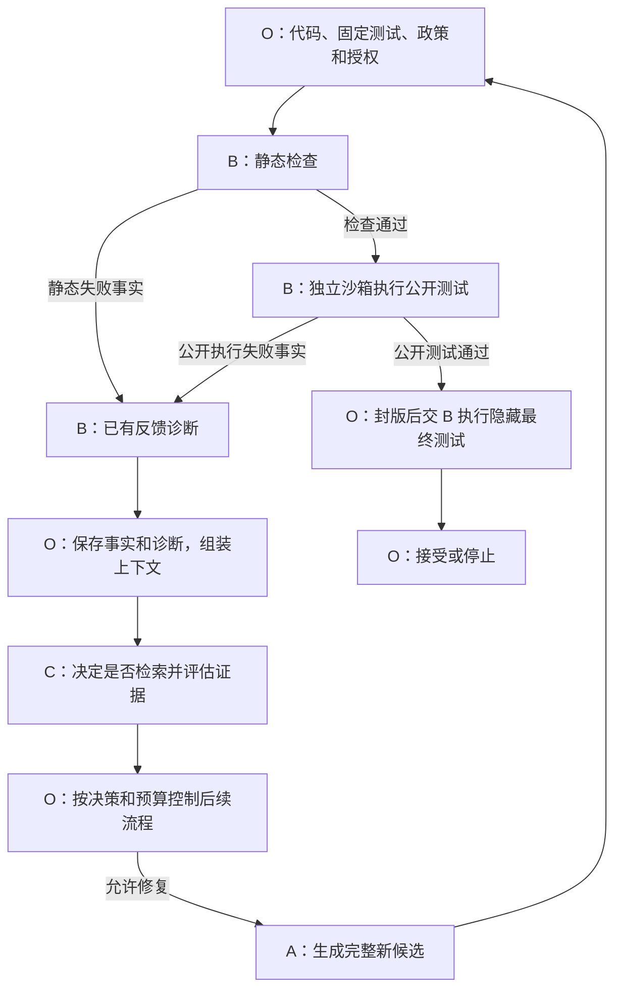

# B 组功能定位与当前项目已实现功能说明

编写日期：2026-11-07，Asia/Shanghai。适用对象：项目组成员、A/C 消费方及 O 集成维护者。

本文依据当前仓库源码、共同规范和已保存的验证记录编写。编写时 B 仓库 HEAD 为 `f4ed4caec4649afde8a99359513a638193c85e7d`，分支为 `b/local-v2-adapter`；当前 `srp_b` 运行核心、规则提取器及 Dockerfile 与固定实现 `c5e04a4ab2f9d80b98439e42228cc3515e0b0534` 一致。共同规范参考框架基线 `55e9f3a945d58df60bd59ab8c57f206e3ebb67bd` 及 B 登记提交 `5ecb03c3c6a6ab0878657cd9ba3bd8ee71990014`。

文中区分“源码已实现”“已有验证证据”和“正式接收完成”。本次编写进行了只读源码与资料核对，没有运行真实模型、Docker 或目标代码，也没有产生新的联合验收结论。

## 1. B 组的功能定位

B 组承担**代码执行反馈与错误诊断**：接收 O 交付的代码、固定测试、构建清单和授权，执行静态检查及独立沙箱测试，再把可核对的失败事实转化为结构化诊断，支持后续检索和修复。

B 的核心价值包括三个方面：

1. **获得事实**：准确记录检查结果、逐测试结果、异常信息、日志、实际环境和终止原因。
2. **解释失败**：根据已有事实提出错误类别、根因假设、位置、知识缺口和下一步建议，并保留不确定性。
3. **提供可靠交接**：使用公共契约、身份关联、内容哈希、证据引用和用量记录，使 O、A、C 能够核对诊断依据。

例如，一段代码未通过测试时，B 应交付“哪个固定测试失败、观察到了什么、依据指向哪里、可能原因及还缺什么信息”。其中测试结果和日志属于事实，根因解释属于可修正的判断。

## 2. 与 A、C、O 的分工和部署关系

| 组别 | 主要职责 | 与 B 的交接 |
|---|---|---|
| A | 生成初版代码和修复候选 | 代码经 O 交给 B；A 从 O 接收允许公开的失败事实和诊断，用于生成新候选 |
| B | 静态检查、独立沙箱执行、已有反馈诊断 | 向 O 交付检查报告、执行事实、诊断及实际用量 |
| C | 检索决策、真实知识检索、证据评估 | 从 O 接收 B 的诊断和知识缺口提示，自主决定是否检索；向 O 提供决策与合格证据 |
| O | 全局状态、上下文、授权预算、版本历史、调度及最终验收 | 调用 B 的公开能力，保存原件，核对交接，决定后续流程及运行终态 |

B 的 `retrieval_hint` 和 `query_hints` 是供 C 使用的建议；C 保持独立决策。B 的 `next_action` 是模块建议，是否发起下一次调用仍由 O 按政策控制。修复候选由 A 产生，B 不在执行结果或诊断中替换当前代码。

当前部署采用 **Python O+A/B/C 同进程，通过 LocalTransport 交接 JSON 兼容对象；目标代码在 B 管理的独立 Docker 容器中执行**。B 模块与目标代码的执行边界不同：检查、调度和诊断可以在主应用中运行，生成源码不在主应用中 `exec/eval` 或导入运行。

以下是规范中的协同关系示意。当前已有混合验证中的 A/C 为明确的 Mock，该图本身不代表全真实流程已经通过。



## 3. 当前交付形态与能力入口

| 项目 | 当前实现 |
|---|---|
| Python 包 | `srp-b-local`，候选版本 `0.4.0` |
| 公共工厂 | `srp_b:create_module` |
| 模块方法 | `capabilities()`、`call(operation, request)` |
| 公共数据版本 | `schema_version=2.0` |
| 传输 | 同进程 LocalTransport；`/api/v2/` 字符串用作逻辑能力标识 |
| 主应用运行时 | Python >=3.11；与共同框架及其他模块依赖兼容 |
| 任务代码范围 | Python 单源码文件、标准库任务、内联文件内容 |
| 测试运行器 | 独立 Docker 中的 pytest，运行前核对实际版本 |
| 调用方式 | 同步调用，能力声明 `supports_async=false`；同一 B 实例内部使用锁串行处理 |
| 诊断后端 | 默认 `rules`，可显式选择 `anthropic` |
| 默认载荷上限 | 完整请求规范 JSON 的 UTF-8 字节不超过 2 MiB，可配置为更小值 |

“单源码文件”指 `CodeArtifact.files` 当前只接受一份源码。测试文件和 `BuildManifest.supporting_files` 按各自清单交接，不因此被限制为整个工作区只能有一个文件。

三项公开业务能力如下：

| 能力 | operation | 主要输入 | 主要输出 |
|---|---|---|---|
| 静态检查 | `/api/v2/validate/static` | 任务、代码、构建清单、检查政策及授权 | `StaticCheckReport` |
| 受控执行 | `/api/v2/execute` | 代码、固定测试、构建清单、执行政策、执行用途及授权 | `ExecutionResult`，包含环境和资源采集状态 |
| 错误诊断 | `/api/v2/diagnose` | 任务、代码、公开测试、已有失败来源、环境、历史及授权 | `DiagnosticResult`，包含原失败来源、`DiagnosisReport` 和建议 |

业务请求使用完整公共信封：正常请求有 17 个必需顶层键，正常响应有 16 个必需顶层键；响应 `payload` 包含 `status/data/error/usage/warnings`。能力声明、传输错误和 O 控制请求使用各自格式。

模块的 `call(operation, request)` 是两参数方法；O 的 `transport.call(service, operation, envelope)` 是三参数方法。真实输入由 O 组装，不能仅传一段代码或 `payload` 就视为完成协议接入。

## 4. 已实现的静态检查

静态检查位于 [module.py](../python_service/srp_b/module.py) 的 `_static`。代码文件、任务关联、路径、哈希和范围约束先在调用入口核对，之后按 `validation_policy.checks` 执行具体检查。

| 检查项 | 当前行为 | 输出及限制 |
|---|---|---|
| `syntax` | 用 Python AST 按请求的 Python 语法版本解析源码 | 返回通过或语法错误及行号；主环境无法提供对应语法时明确阻塞 |
| `entry_point` | 检查构建入口是否对应已交付源码路径 | 核对入口文件存在性；不等同于验证所有函数签名或业务行为 |
| `artifact_integrity` | 在入口已校验的基础上报告文件及集合摘要一致 | 正文、路径或哈希不一致的输入会在前置校验中拒绝 |
| 其他请求检查项 | 不推断为已通过 | 返回未知检查结果，使静态报告保持 blocked |

当前静态检查主要是语法、入口文件和制品完整性检查。完整类型分析、通用代码质量分析及任意自定义规则未作为现有 v2 能力交付。标准库导入名筛查属于受支持范围预检，其结果不等于完整的静态安全分析。

语法失败只产生静态事实。后续使用 `static_feedback` 诊断时，失败来源中不补造 `execution_result` 字段。

## 5. 已实现的独立沙箱执行

执行核心位于 [sandbox.py](../python_service/srp_b/sandbox.py) 的 `DockerRunner`。B 根据当前授权和固定输入创建临时工作区，将代码、测试和支持文件交给 Docker 中的 pytest。目标执行期间不联网安装依赖。

### 5.1 受支持输入与环境核对

- 代码必须是 Python 单源码文件，任务依赖列表为空；显式非标准库导入名会被范围预检阻塞。
- 构建测试命令限定为 `python -m pytest` 或 `python3 -m pytest` 加已交付测试路径，不接受任意 shell 命令或任意测试参数。
- 构建依赖仅接受当前支持的固定 `pytest==x.y.z` 声明，并与镜像中的实际版本核对。
- 先查询配置镜像的实际 image ID，再用该 ID 探测 Python 和 pytest 版本，并用于目标容器启动。
- 请求运行时与实际运行时不匹配、测试运行器版本不匹配或环境不可用时，保留环境失败事实，不伪造目标测试通过。

[Dockerfile](../docker/b-local/Dockerfile)使用 `python:3.11-slim` 并在构建阶段安装 `pytest==8.3.5`。实际环境以每次探测结果和 image ID 为准；软件版本 `0.4.0`、配置镜像标签 `srp-b-python:0.3.0` 与实际镜像身份需要分别记录。

### 5.2 已实施的执行限制

| 控制项 | 当前实现 |
|---|---|
| 网络 | 目标容器使用 `--network none` |
| 用户与权限 | 非 root 用户 `65534:65534`，丢弃 capabilities，启用 `no-new-privileges` |
| 文件系统 | 容器根文件系统和代码工作区只读；授权写目录使用受限 tmpfs，测试报告使用私有报告文件 |
| 资源 | 按政策施加内存、CPU 和进程数限制；写目录不能覆盖代码、测试或支持文件 |
| 时间 | 受信封、CallGrant、预算和执行政策时间限制共同约束 |
| 输出 | 持续读取 stdout/stderr，每个流保留前 32 KiB；合计输出超过 1 MiB 阈值时停止命令 |
| 报告 | 校验 JUnit XML 文件路径、文件类型和大小，拒绝不允许的 XML 声明；报告上限 2 MiB |
| 生命周期 | 执行结束清理探测及目标容器；清理无法确认时返回基础设施异常并保留事实 |

不支持的政策明确返回拒绝结果，不切换为主进程执行。上述内容描述当前施加和记录的控制项；隔离能力的已测范围仍需结合对应版本的实际运行证据判断。

### 5.3 执行结果实际记录什么

`ExecutionResult` 关联任务、尝试、代码版本、代码哈希、测试 ID/哈希、执行配置哈希及新的 `execution_id`，并包含：

- 执行状态、测试结论、退出码、失败阶段、终止原因及可得信号信息。
- stdout/stderr 的已保留文本、摘要及截断标记。
- 每个测试的 ID、passed/failed/error/skipped 状态、错误消息和可得位置。
- 请求与实际运行时、已观察包版本、实际镜像 ID、隔离配置及清理确认状态。
- 资源字段及其采集状态。

当前实现有几项明确限制：

1. CPU 时间和峰值内存尚未采集，保留 `null/unknown`。墙钟时间反映沙箱执行流程的耗时，包含准备、探测和清理等开销，不作为纯目标 CPU 时间。
2. 逐测试 `expected/actual` 当前保留为 `null`；断言与异常详情主要来自测试 `message` 和日志。
3. 独立结构化 `traceback` 帧列表当前保持为空；原始回溯信息主要保存在测试消息或日志中。
4. 缺少有效逐测试报告、报告为空或只有跳过项时，不据退出码零推断全部测试通过。

**模块响应 `completed` 表示本次能力调用完成。代码测试失败仍可返回 completed 的执行结果，测试是否通过应读取 `ExecutionResult.test_outcome`。**

## 6. 已实现的错误诊断

### 6.1 两种必需模式

| 模式 | 使用的事实 | 当前行为 |
|---|---|---|
| `static_feedback` | 已有 `StaticCheckReport` | 分析真实静态 findings，保留原静态失败来源 |
| `feedback_only` | 已有公开 `ExecutionResult` | 分析原逐测试结果和日志，不新增目标执行 |

当前 B 不声明 `execute_then_diagnose`；收到组合执行诊断请求会明确阻塞。执行与诊断分别授权、分别记录，诊断失败不能抹掉之前已完成的执行事实。

### 6.2 默认规则诊断

[diagnosis.py](../python_service/srp_b/diagnosis.py)复用[规则提取器](../python_service/app/analyzer/error_signal_extractor.py)，结合执行状态、静态 findings、失败测试及日志形成报告。已包含语法/缩进错误、断言失败、导入失败、除零、下标越界、类型错误、未定义名称、递归/资源信号等规则，以及对超时、政策和环境状态的处理。

报告的主要内容如下：

| 信息 | 主要字段及含义 |
|---|---|
| 失败分类 | `failure_class`、`raw_failure_class`、`failure_domain`、`failure_stage` |
| 根因与假设 | `root_cause`、`confidence`、`hypotheses` |
| 位置与依据 | `locations`、`evidence_refs` |
| 信息充分性 | `local_context_sufficiency`、`context_gap` |
| 检索及后续建议 | `retrieval_hint`、`query_hints`、`suggestions`、`next_action` |
| 历史关联 | `prior_diagnosis_id`、`failure_signature` 和代码/事实身份 |

当前规则主要进行错误信号匹配和事实分类。规则置信度是启发式数值，尚无经过标注集校准的准确率证明；命中 `AssertionError` 也不能单独证明具体算法根因。缺少依据时返回信息不足或未知，不生成无依据的证据指针。

当前 `context_gap` 主要表达诊断证据不足，`query_hints` 主要由已识别的导入/依赖错误等规则生成；它们尚不代表已经实现通用的语义知识缺口识别模型。

### 6.3 证据与事实保留

- 逐测试失败引用实际 `/test_case_results/{index}`；静态失败引用实际 `/findings/{index}`。
- 日志引用保持 stdout 或 stderr 的真实来源，合并用于分析的文本不伪装成单一 stderr 来源。
- 返回的 `failure_source` 保持原事实；原始执行结论不因诊断解释变化而改写。
- 无可引用观察时，不生成看似确定的失败假设。
- 诊断故障通过 `partial_result_ref` 保留此前已有事实，供 O 按授权解析和核对。

### 6.4 可选 Claude SDK 诊断

0.4.0 新增 [claude.py](../python_service/srp_b/claude.py)，通过显式 `diagnosis_backend="anthropic"` 启用。默认规则模式、能力发现、静态检查和目标执行均不调用模型。

模型增强的当前边界为：

1. 先完成公共契约、授权、可见性、哈希及事实校验，并形成规则分析。有可引用失败假设时才进入 SDK 路径。
2. 使用 SDK `messages.count_tokens` 预检实际输入；一次诊断最多提交一次推理，SDK `max_retries=0`。词元计数是额外服务请求，不计作一次文本推理。
3. 提供当前任务、代码、公开测试、失败事实、环境、历史、获授权 prior 诊断和已解析日志。
4. 模型只返回根因解释、建议及已有证据索引，不调用工具、检索、执行代码或生成替换代码；失败分类、父关系、执行事实及下一动作仍由既有逻辑维护。
5. 记录服务端实际词元用量及缓存输入词元；未知用量保留未知，费用未计价时保持 `null`。
6. 截断、无效 JSON、无效证据索引、未知用量和超授权均有明确错误处理；不静默改写成零消耗的规则成功。
7. SDK 原始观察保存在 B 私有状态中，公共响应不回显服务端异常正文或密钥。

模型 ID 由部署者显式选择，密钥通过进程环境变量注入。真实账号/模型/API 可用性与实际请求用量仍待验证。详细参数和安装方法见 [Claude 接入说明](claude_sdk_integration.md)。

## 7. 已实现的交接、状态和保护机制

| 机制 | 当前实现 | 与 O 的责任关系 |
|---|---|---|
| 公共契约 | 输入输出 Schema 校验，JSON 值副本交接，operation 和载荷大小检查 | O 通过公开模块入口调用 |
| 身份与完整性 | 核对任务/尝试、代码、测试、构建、失败事实、环境关联及内容摘要 | 跨轮父关系和修复权限仍由 O 的全局守卫控制 |
| 不可变版本 | 私有日志登记代码版本摘要、每个 run 的固定 public/final 测试身份及哈希 | 不能以相同版本身份替换内容或更换固定测试 |
| 调用授权 | 核对 CallGrant 与预算 ID/修订、可用额度、执行/模型授权及最早期限 | O 是总预算、预约和结算的所有者；B 不自行扩权 |
| 持久重放 | SQLite 按 operation/message_id 保存请求摘要及完成响应，另约束 call_id 复用 | 同键同文返回原响应与原 usage_id；同键异文拒绝 |
| 未知结果 | pending 调用返回未知状态，保留关联，不自动重新执行或重新推理 | O 保留未结算预约并按政策核对 |
| 受控引用 | 声明 `local-store`，通过当前调用绑定的只读解析器读取获授权引用并检查摘要 | O/LocalTransport 负责引用授权范围与调用结束解绑；消费者不读取 B 私有 SQLite |
| 原件与部分完成 | 分开保存静态报告、执行事实、诊断及模型观察 | O 保存跨组原件和运行记录，B 的本地日志不替代 O 全局状态 |

私有日志位于配置的 `state_dir`，当前使用 `calls.sqlite3`，包括 calls、facts、versions、fixed_tests 和 model_observations 等表。每次数据库操作关闭连接；没有独立后台 B 服务或需要消费者访问的内部数据库接口。

LocalTransport 的同步期限检查与目标容器的执行超时属于不同边界。当前没有异步任务队列、强制取消运行中插件或自动崩溃续跑能力。

### 隐藏最终验收

O 负责在候选封版后发起最终验收。B 的执行入口校验 `purpose=final_acceptance`、restricted 可见性与 `final_hidden` 测试类型的对应关系，使用独立受控执行返回受保护事实。

公开诊断入口拒绝受保护最终测试、最终验收和 restricted 反馈。隐藏测试内容及逐项失败不进入 A/C 或公开诊断；最终失败后是否停止、是否还允许调用模块，由 O 的验收状态控制。已有混合技术验证记录支持对应保护行为，正式验收仍需绑定实际材料和接收版本。

## 8. 源码组织与既有代码的关系

| 文件或目录 | 当前作用 |
|---|---|
| [srp_b/__init__.py](../python_service/srp_b/__init__.py) | 版本与公开工厂、显式工厂选项 |
| [srp_b/module.py](../python_service/srp_b/module.py) | 能力声明、契约入口、授权/上下文检查、静态检查及业务分发 |
| [srp_b/sandbox.py](../python_service/srp_b/sandbox.py) | Docker 环境核对、执行限制、日志/逐测试采集和清理 |
| [srp_b/diagnosis.py](../python_service/srp_b/diagnosis.py) | 规则诊断、证据指针、知识缺口与建议 |
| [srp_b/claude.py](../python_service/srp_b/claude.py) | 可选 SDK 解释、输入预检、真实用量和失败处理 |
| [srp_b/state.py](../python_service/srp_b/state.py) | 私有事实日志、不可变身份、持久重放和未知状态 |
| [srp_b/samples.py](../python_service/srp_b/samples.py) | 公开合成样例与重建辅助 |
| [app/analyzer/error_signal_extractor.py](../python_service/app/analyzer/error_signal_extractor.py) | 当前 v2 复用的规则信号提取器 |
| [docker/b-local/](../docker/b-local/) | 本地 v2 执行镜像构建入口 |
| [python_service/tests/](../python_service/tests/) | 契约、诊断、SDK 和 P2 技术边界回归 |

仓库中还保留 Java、FastAPI、REST/A2A/MCP、CodePilot 和评测工具等既有代码。当前共同框架使用 `srp_b` 的本地 v2 工厂接入；旧入口各自具有历史用途，不应把它们全部算入已完成的 M1 能力。当前 v2 仍依赖 `app` 中的规则提取器，包配置也保留 `app*`，不能按目录名称直接删除旧模块。

## 9. 已有验证证据与当前完成程度

下表引用已保存记录，日期沿用原执行日期；不是本文编写时重新运行的结果。

| 版本/阶段 | 已有证据 | 可以支持的结论 | 仍未覆盖的范围 |
|---|---|---|---|
| 0.3.1 / P1 | 2026-10-24：46 项适配、99 项共同框架、182 项旧 B 测试通过，3 项旧 Docker 测试跳过；另有真实 Docker 和混合流程记录 | B 已有真实静态、规则和独立执行来源证据 | 不证明 A/C 全真实或 O 已签收 |
| 0.3.1 / P2 技术矩阵 | 历史、父关系、固定测试、引用、预算/重放、异常和保护视图；打包阶段 105 项定向回归通过 | B 自有技术矩阵已有证据，部分流程使用真实 Docker 与 O | A/C 明确 Mock；正式任务锁定、消费意见和 O 接收仍缺 |
| 0.4.0 / SDK 候选 | 2026-11-02：132 项 B 测试，包含 44 项 SDK 用例；99 项共同框架回归；wheel 构建/独立解压加载 | 可选 SDK 集成、授权、用量和重放的离线验证已有记录 | 真实 API、新版本 Docker、干净依赖环境安装和 O 独立接收未完成 |
| 0.4.0 / 发布及登记 | 2026-11-04：26 份源码绑定固定实现提交；两项真实静态/规则公开样例及登记检查 | 候选版本可获取，公开材料与实现有绑定关系 | 发布、登记和资料同步不替代新运行或正式签收 |

证据入口：

- [P1 审查](p1_delivery_review_20261024.md)、[0.3.1 本地交付](local_v2_handoff.md)。
- [P2 汇总](p2_handoff_20261030.md)、[技术验收矩阵](verification/p2/acceptance_matrix.json)。
- [0.4.0 SDK 验证](verification/claude_sdk_validation.json)、[固定发布记录](verification/claude_sdk_publication.json)。
- [0.4.0 当前交付](local_v2_handoff_v0.4.0.md)、[框架资料同步说明](framework_sync_20261107.md)。

当前合适的进度表述是：**B 单模块候选已交付，0.3.1 有真实 Docker/P2 混合技术证据；0.4.0 有静态/规则及 SDK 离线验证。正式 P2 接收、P3 全真实链和 M1 签收尚无完成证据。**

## 10. 尚待完成的接入工作与后续研究

| 事项 | 具体缺项 | 责任关系 |
|---|---|---|
| 选定接收版本 | 明确使用 0.3.1 规则基线，或 0.4.0 的 rules/anthropic 模式，固定提交、配置与镜像 | O 与 B/消费方确认 |
| 选定版本独立复核 | 接收方独立安装、加载、真实执行及政策核对；0.4.0 还缺新的 Docker 和干净依赖环境记录 | B 配合，O/接收方复核 |
| 真实 SDK 验证 | 若选择 anthropic 模式，补实际获授权模型、真实响应与 Usage；密钥留在部署环境 | B/O 部署环境 |
| 正式共同材料 | 开发任务、固定公开/隐藏测试、知识快照、实际 A 模型窗口/tokenizer、环境及预算锁定 | O 汇总，各组提供 |
| 消费方接收 | A/C/O 核对失败来源、诊断、环境、历史及保护视图，填写实际接收意见 | 生产方、消费方与 O |
| 全真实闭环 | 真实 A/C 接入后，完成自然失败—诊断—检索/评估—修复—再执行及规定分支 | A/B/C/O 联合 |

规范允许 B 使用规则或模型。若验收选择规则模式，真实 Claude 调用不是 M1 的统一必选条件；实际所选版本及其三项能力仍需真实来源和接收证据。

后续算法研究可以围绕以下方向开展，但需要与接入验收分开记录：

- **事实采集质量**：区分代码失败、环境/执行器故障、超时、OOM、信号和政策阻塞，统计事实捕获错误。
- **诊断质量**：使用事前标注样本评估类别、阶段、领域、位置、根因假设和不确定性，分别统计事实错误与判断错误。
- **规则与模型比较**：固定同一失败事实、输入、预算及评分标准，比较有效假设、证据正确性和成本。
- **知识缺口提示质量**：评估 B 的提示是否帮助 C 作出合适决策；实际检索及合格证据判定仍由 C 完成。

当前没有材料支持对外声明通用诊断准确率、RAG 修复收益或生产吞吐已达到某个阈值。

## 11. 接入使用示意与材料入口

以下代码只展示接口形状，本文编写时未执行该示例：

```python
from srp_b import create_module

module = create_module(
    state_dir=".interop/b-state",
    image="srp-b-python:0.3.0",
    diagnosis_backend="rules",
)
descriptor = module.capabilities()

# request_envelope 由 O 按公共契约组装，包含完整授权与上下文。
# response = module.call("/api/v2/validate/static", request_envelope)
# response = module.call("/api/v2/execute", request_envelope)
# response = module.call("/api/v2/diagnose", request_envelope)
```

不同 operation 使用对应的请求对象，不能将同一 payload 不加适配地发给三项能力。完整安装和配置以 [README](../README.md)、[0.4.0 交付说明](local_v2_handoff_v0.4.0.md)为入口，规则和 SDK 模式分别使用[规则配置](integration/config.b-local.v0.4.0.example.json)与 [Claude 配置](integration/config.b-local.claude.example.json)。

能力及公开报文见 [0.4.0 能力声明](contracts/v2/capabilities_v0.4.0.json)、[静态/规则注册样例](contracts/v2/examples_v0.4.0.json)和 [0.3.1 历史完整样例](contracts/v2/local_samples.json)。样例身份、期限和哈希应按新调用实际重建，原报文不直接用作当前授权。

正式接收使用 [O/消费方核对单](integration/receiver_checklist_v0.4.0.md)。[M1 准备报告](m1_readiness_20261105.md)保留的是截至 2026-11-04 的缺口快照，后续签收需补充新的实际记录。

共同规范中的职责依据见固定版本的[各组范围约束](https://github.com/H1Unter3/Collaborative_Reliable_CodeGen_Loop/blob/55e9f3a945d58df60bd59ab8c57f206e3ebb67bd/docs/01_%E5%90%84%E7%BB%84%E5%AE%9E%E7%8E%B0%E8%8C%83%E5%9B%B4%E4%B8%8E%E7%BA%A6%E6%9D%9F.md)及 [M1 里程碑](https://github.com/H1Unter3/Collaborative_Reliable_CodeGen_Loop/blob/55e9f3a945d58df60bd59ab8c57f206e3ebb67bd/docs/11%E6%9C%885%E6%97%A5%E7%9C%9F%E5%AE%9E%E6%A8%A1%E5%9D%97%E6%8E%A5%E5%85%A5%E9%AA%8C%E8%AF%81%E9%87%8C%E7%A8%8B%E7%A2%91.md)。
